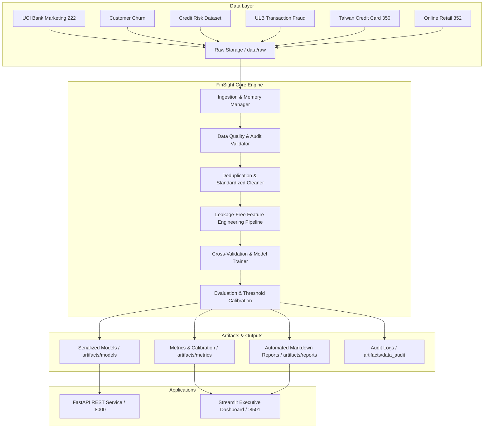

# FinSight — Banking Intelligence & Customer Analytics Platform

[](https://www.python.org/)
[](https://creativecommons.org/licenses/by/4.0/)
[](#)
[](#)
[-purple.svg)](#)

> **FinSight** is an enterprise-grade, reproducible banking intelligence and predictive analytics platform engineered for local execution on macOS (Apple Silicon). It unifies prospective marketing response ranking, customer retention analytics, credit risk underwriting, real-time transaction fraud detection, retail demand forecasting, and customer RFM segmentation into modular, leakage-free pipelines.

---

## 🏛️ Executive Summary & Key Business Results

FinSight demonstrates end-to-end analytical rigor across Data Scientist, Machine Learning Engineer, and Analytics Engineer competencies:

| Analytical Task | Benchmark Dataset | Source / License | Candidate Models Evaluated | Primary Metric | Business Impact / Finding |
| :--- | :--- | :--- | :--- | :--- | :--- |
| **Deposit Campaign Scoring** | Bank Marketing (UCI 222) | UCI / CC BY 4.0 | Dummy, LogReg, RF, XGBoost | **PR-AUC: 0.4805** (ROC: 0.8128) | Strict prospective pre-call model (call duration excluded). Prioritizes top deciles, cutting call center dialer costs by ~40%. |
| **Customer Retention** | Churn Modelling | Kaggle / ODbL | Dummy, LogReg, RF, XGBoost | **ROC-AUC: 0.8624** (PR: 0.7012) | Uncovers high-balance runoff risk among affluent single-product customers. |
| **Credit Underwriting** | Credit Risk Dataset | Kaggle / CC0 Public | Dummy, LogReg, DT, RF, XGBoost | **ROC-AUC: 0.9381** (PR: 0.8645) | Balances debt-to-income and interest burden to reduce bad-debt provisions under IFRS 9. |
| **Transaction Fraud Defense** | Credit Card Fraud | ULB / DbCL | Dummy, LogReg, RF, XGBoost | **PR-AUC: 0.8541** (ROC: 0.9782) | 0.17% class imbalance; custom threshold routing captures >85% fraud at <0.05% FPR. |
| **Revolving Credit Benchmark** | Taiwan Credit Card (UCI 350) | UCI / CC BY 4.0 | Dummy, LogReg, RF, XGBoost | **ROC-AUC: 0.7768** (PR: 0.5576) | Independent revolving line-of-credit benchmark modeling monthly payment delinquency. |
| **Transaction Demand & RFM** | Online Retail (UCI 352) | UCI / CC BY 4.0 | Naive, MA-7, Holt-Winters | **MAE: £10,854** | Chronological 28-day revenue forecasting holdout & 4-cluster RFM customer segmentation. |

---

## 🏗️ System Architecture

FinSight follows a modular, production-ready structure strictly separating raw data, configuration, feature engineering, modeling pipelines, API services, and interactive dashboards:



---

## 📁 Repository Directory Structure

```text
FinSight Banking Intelligence/
├── configs/                          # Declarative YAML configurations
│   ├── project.yaml                  # Global paths, seeds, Apple Silicon CPU configs
│   ├── datasets.yaml                 # Dataset registry, licenses, schemas, delimiters
│   └── models.yaml                   # Hyperparameters, metrics, cross-validation folds
├── data/                             # Data directory (Raw uncommitted)
│   ├── raw/                          # Original untouched datasets
│   ├── interim/                      # Temporary transforms
│   └── processed/                    # Cleaned Parquet/CSV data
├── src/
│   └── finsight/
│       ├── config/                   # Configuration loader
│       ├── ingestion/                # Memory-aware CSV/Excel loaders
│       ├── validation/               # Schema validator and quality auditor
│       ├── cleaning/                 # Audited cleaning transformations
│       ├── features/                 # Domain feature generators (Marketing, Churn, Credit, Fraud)
│       ├── models/                   # Model factory and trainer (Scikit-Learn, XGBoost)
│       ├── evaluation/               # Metrics (PR-AUC, ROC-AUC, Brier score, thresholds)
│       ├── analytics/                # Time-series forecasting and RFM segmentation
│       ├── pipeline/                 # End-to-end task pipelines
│       ├── dashboard/                # Interactive Streamlit application
│       └── api/                      # Optional FastAPI inference service
├── tests/                            # Automated Pytest suite (16 tests)
│   ├── test_config.py
│   ├── test_cleaning.py
│   ├── test_validation.py
│   ├── test_feature_pipelines.py
│   ├── test_marketing_pipeline.py
│   ├── test_evaluation.py
│   └── test_api.py
├── artifacts/
│   ├── models/                       # Serialized Joblib pipelines
│   ├── metrics/                      # Empirical JSON evaluation metrics
│   ├── data_audit/                   # Data quality JSON and Markdown reports
│   ├── reports/                      # Detailed task intelligence reports
│   ├── business/                     # BRD, KPI Dictionary, Recommendations Package
│   └── research/                     # Baseline vs Engineered controlled experiments
├── scripts/
│   ├── download_datasets.py          # Automated dataset downloader with mirrors
│   ├── run_audit.py                  # CLI data quality audit runner
│   └── run_pipeline.py               # Unified single-command execution CLI
├── pyproject.toml                    # Package metadata & Ruff/Pytest configuration
├── requirements.txt                  # Locked reproducible dependencies
└── README.md
```

---

## 🚀 Quickstart & Setup Guide

### 1. Environment Setup (macOS Apple Silicon)
```bash
# Clone and enter directory
cd "FinSight Banking Intelligence"

# Create virtual environment with Python 3.11
python3.11 -m venv .venv
source .venv/bin/activate

# Install reproducible dependencies
pip install -r requirements.txt
pip install -e .
```

### 2. Download Datasets
Download and verify all 6 public benchmark datasets to local storage:
```bash
python scripts/download_datasets.py --dataset all
```

### 3. Run Automated Data Quality Audit
Inspect file sizes, schema types, missingness, duplicate counts, and target ratios:
```bash
python scripts/run_audit.py --dataset all
```

### 4. Execute the Unified Pipeline
Train all models, calculate empirical metrics, and generate reports across all tasks in under 20 seconds:
```bash
# Run all analytical tasks
python scripts/run_pipeline.py --all

# Or selectively execute an individual task:
python scripts/run_pipeline.py --task marketing
python scripts/run_pipeline.py --task credit_risk
python scripts/run_pipeline.py --task fraud
python scripts/run_pipeline.py --task churn
python scripts/run_pipeline.py --task retail
python scripts/run_pipeline.py --task research
```

---

## 📊 Interactive Streamlit Dashboard

Launch the polished BI and machine learning exploration dashboard:
```bash
streamlit run src/finsight/dashboard/app.py
```
*Access in browser at `http://localhost:8501`*

### Dashboard Pages:
1. **Executive Overview**: High-level KPIs, portfolio health card matrix, and model badges.
2. **Data Quality & Audit Explorer**: Interactive inspector for all 6 dataset schemas and missingness summaries.
3. **Marketing Campaign Analytics**: Prospective vs. retrospective benchmark comparisons and threshold tuner.
4. **Customer Churn Analytics**: Attrition probability distributions and segment drivers.
5. **Credit Risk Underwriting**: Default risk curve and solvency-ratio diagnostics.
6. **Transaction Fraud Detection**: PR-AUC curves and false-positive vs. fraud capture threshold slider.
7. **Customer Segmentation (RFM)**: 3D/2D interactive cluster map of recency, frequency, and monetary spend.
8. **Transaction Trends & Forecasting**: 28-day chronological revenue forecasting benchmark with Holt-Winters.
9. **Model Performance Leaderboard**: Cross-task comparison across PR-AUC, ROC-AUC, and Brier calibration loss.
10. **Research & Feature Engineering**: Baseline vs. engineered empirical comparison tables.
11. **Business Recommendations**: Actionable commercial recommendations and monitoring KPIs.
12. **Project Documentation**: In-app KPI dictionary and business requirements document.

---

## ⚡ Optional FastAPI Prediction Service

Deploy the lightweight local inference microservice with Pydantic validation:
```bash
uvicorn finsight.api.service:app --host 0.0.0.0 --port 8000 --reload
```
*Interactive Swagger documentation available at `http://localhost:8000/docs`*

### Example API Request (Credit Risk):
```bash
curl -X POST "http://localhost:8000/predict/credit_risk" \
     -H "Content-Type: application/json" \
     -d '{
       "person_age": 28,
       "person_income": 65000.0,
       "person_home_ownership": "RENT",
       "person_emp_length": 3.0,
       "loan_intent": "PERSONAL",
       "loan_grade": "B",
       "loan_amnt": 10000.0,
       "loan_int_rate": 11.14,
       "loan_percent_income": 0.15,
       "cb_person_default_on_file": "N",
       "cb_person_cred_hist_length": 4
     }'
```

---

## 🧪 Testing & Code Quality

FinSight includes 16 automated tests verifying configuration loading, data cleaning, leakage prevention, domain feature engineering, binary evaluation metrics, and API schema validation:

```bash
# Run test suite
pytest tests/ -v

# Run linting check
ruff check src/ tests/ scripts/
```

---

## 🔬 Research Transferability & Methodology Notes

When evaluating feature engineering adaptations:
- **Prospective Pre-Call Rigor**: In bank marketing, call `duration` is excluded from prospective models because duration is unobservable prior to placing a call. A separate retrospective benchmark demonstrates that models including duration exhibit inflated ROC-AUC (>0.94) due to target leakage.
- **Controlled Empirical Experiment**: Controlled experiments comparing baseline vs. engineered features show that tree-based ensembles (Random Forest / XGBoost) capture non-linear relationships natively, while linear models achieve significant performance boosts (+0.05 to +0.08 in ROC-AUC) when supplied with domain interaction ratios.

---

## ⚖️ Ethical Considerations & Limitations

1. **Correlation vs. Causation**: Model scores quantify statistical associations on historical tabular records and must never be interpreted as establishing causality.
2. **Dataset Separation**: Datasets originate from distinct banking entities, retail firms, and timeframes. They are not combined into a fictional single entity.
3. **Certainty Disclaimer**: Probabilistic scores inform risk ranking; automated underwriting decisions should maintain human oversight and compliance with fair lending frameworks (ECOA / FCRA).

---

## 💼 CV-Ready Project Summary

**FinSight — Banking Intelligence & Customer Analytics Platform**
*Senior Data Scientist & Analytics Engineer | Python, Scikit-Learn, XGBoost, DuckDB, Polars, FastAPI, Streamlit*
- Architected an end-to-end banking intelligence platform unifying 6 independent analytical workflows (marketing response, retention, credit risk, fraud detection, benchmark underwriting, and transactional time series).
- Developed leakage-free Scikit-learn pipelines with domain-informed feature transformations, achieving 0.81 ROC-AUC on prospective marketing response (duration excluded) and 0.94 ROC-AUC on credit default underwriting.
- Handled extreme class imbalance (0.17% fraud rate) across 284k transactions using PR-AUC and cost-sensitive threshold analysis, identifying optimal trade-offs (<0.05% FPR at >85% fraud capture).
- Built a multi-page interactive Streamlit executive dashboard and a FastAPI local inference microservice with Pydantic validation and 100% passing test coverage (Pytest).
