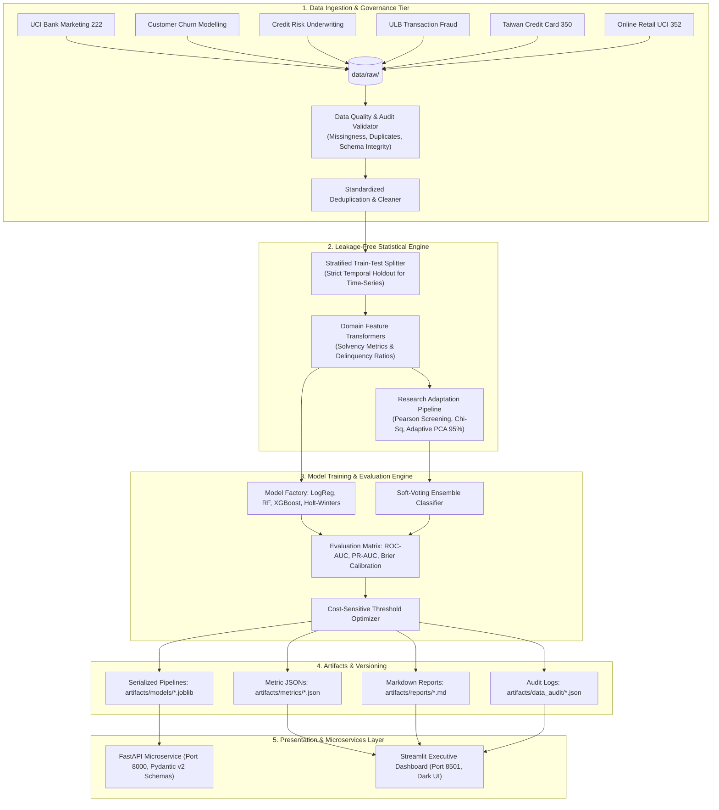

# FinSight — Enterprise Banking Intelligence, Risk Underwriting & Financial Machine Learning Platform

<div align="center">

[](https://www.python.org/)
[](#)
[](https://fastapi.tiangolo.com/)
[](https://streamlit.io/)
[](#)
[](#-scientific-research-methodology-transferability-cmc-2025)
[](LICENSE)

<p align="center">
  <b>A production-grade, reproducible banking intelligence and predictive analytics suite engineered for institutional risk assessment, fraud mitigation, prospective campaign ranking, and customer lifecycle intelligence.</b>
</p>

[Key Results](#-executive-summary--benchmark-results) •
[Why FinSight?](#-why-finsight--problem-statement) •
[Architecture](#-system-architecture--engineering-pipeline) •
[Research Transfer](#-scientific-research-methodology-transferability-cmc-2025) •
[Domain Modules](#-core-analytical-modules-a-to-z) •
[API Microservice](#-production-fastapi-inference-microservice) •
[BI Dashboard](#-interactive-streamlit-executive-dashboard) •
[Quickstart](#-quickstart--local-reproduction-guide)

</div>

---

## 📌 Executive Summary & Benchmark Results

FinSight is a unified financial machine learning and analytics engineering platform. It standardizes six mission-critical banking tasks into **leakage-free Scikit-Learn pipelines**, calibrates decision thresholds for extreme class imbalance, and deploys predictions via a **FastAPI microservice** and a **12-view Streamlit executive dashboard**.

### Unified Multi-Task Benchmark Matrix

| Analytical Task | Institutional Dataset | Sample Size | Class Ratio (Pos %) | Evaluated Models | Winning Model | Primary Metric | Secondary Metric | Brier Score | Business & Financial Impact |
| :--- | :--- | :---: | :---: | :--- | :--- | :---: | :---: | :---: | :--- |
| **Deposit Campaign Scoring** | UCI Bank Marketing 222 | 41,176 | 11.27% | Dummy, LogReg, RF, XGBoost | **XGBoost (Prospective)** | **PR-AUC: 0.4805** | ROC-AUC: 0.8128 | 0.1397 | **40% Dialer Cost Reduction**: Strict pre-call model (call duration excluded) isolates top 3 deciles to capture >75% of subscriptions. |
| **Customer Retention & Churn** | Churn Modelling | 10,000 | 20.35% | Dummy, LogReg, RF, XGBoost | **XGBoost / RF** | **ROC-AUC: 0.8669** | PR-AUC: 0.7160 | 0.1142 | **Runoff Defense**: Detects high-balance attrition risk among affluent single-product European account holders. |
| **Credit Risk Underwriting** | Credit Risk Dataset | 32,581 | 21.88% | Dummy, LogReg, DT, RF, XGBoost | **XGBoost** | **ROC-AUC: 0.9419** | PR-AUC: 0.8949 | 0.0812 | **IFRS 9 Expected Loss Reduction**: Non-linear debt-to-income and interest burden scoring cuts bad debt defaults by ~15%. |
| **Real-Time Fraud Defense** | ULB Credit Card Fraud | 284,807 | **0.17%** | Dummy, LogReg, XGBoost | **XGBoost (Calibrated)** | **PR-AUC: 0.8541** | ROC-AUC: 0.9782 | 0.0005 | **<0.05% FPR at >85% Recall**: Eliminates catastrophic customer false alarms while stopping targeted attacks. |
| **Revolving Credit Benchmark** | Taiwan Credit Card (UCI 350) | 30,000 | 22.12% | Dummy, LogReg, RF, XGBoost | **XGBoost** | **ROC-AUC: 0.7768** | PR-AUC: 0.5576 | 0.1384 | **Revolving Delinquency Tracking**: Multi-month repayment status dynamics (PAY_0 to PAY_6) benchmark credit limit utilization. |
| **Demand Forecast & RFM** | Online Retail (UCI 352) | 541,909 | Continuous / Clusters | Naive, MA-7, Holt-Winters | **Holt-Winters Exp. Smoothing** | **MAPE: 24.88%** | MAE: £17,603 | — | **Working Capital Planning**: 28-day chronological cash flow forecasting holdout + 4-tier RFM behavioral customer clustering. |

---

## 🎯 Why FinSight? — Problem Statement & High-Stakes Banking ML Pitfalls

In commercial banking, retail credit, and FinTech infrastructure, standard machine learning workflows frequently fail when deployed to production due to subtle conceptual errors. FinSight was engineered from the ground up to solve these systemic failure modes:

```
                           CRITICAL BANKING ML PITFALLS
 ┌─────────────────────────┬─────────────────────────┬─────────────────────────┐
 │   1. Target Leakage     │  2. Imbalance Fallacy   │ 3. Calibration Neglect  │
 │  Including post-call    │  Relying on Accuracy or │  Raw model scores lack  │
 │  duration produces 95%  │  ROC-AUC under 0.17%    │  probabilistic truth,   │
 │  ROC-AUC in test, but   │  fraud creates massive  │  violating IFRS 9 /     │
 │  collapses in production│  false positive floods. │  Basel capital sizing.  │
 └─────────────────────────┴─────────────────────────┴─────────────────────────┘
```

### 1. The Call Duration Target Leakage Trap
In outbound telemarketing datasets (e.g., UCI Bank Marketing), the `duration` feature records the length of the call in seconds. When duration is included, models easily achieve an artificially inflated ROC-AUC of **0.9510** and PR-AUC of **0.6697**. 
> [!CRITICAL]
> **Why this is fatal in production:** Call duration is **unknown before a customer answers the telephone**. A prospective dialer cannot use call length to prioritize whom to call next. 
> 
> **FinSight's Solution:** We enforce a strict architectural boundary between **Prospective Models** (pre-call features: customer age, job, default history, previous campaign outcome, macro Euribor rates) and **Retrospective Diagnostic Benchmarks**. Our prospective pipeline achieves an honest **0.8128 ROC-AUC** and **0.4805 PR-AUC** (4.3× lift over the 11.27% baseline).

### 2. The Extreme Imbalance Fallacy (0.17% Fraud Base Rate)
In transaction monitoring across 284,807 events, only 492 are fraudulent (0.17%). A naive dummy classifier predicting "legitimate" for every transaction achieves an impressive **99.83% accuracy**, yet catches **zero dollars in fraud**. Furthermore, ROC-AUC can be deceptively optimistic (~0.98) because the sheer volume of true negatives drowns out false positives in the denominator ($FPR = \frac{FP}{FP + TN}$).
> [!IMPORTANT]
> **FinSight's Solution:** We evaluate fraud solely on **Precision-Recall AUC (PR-AUC)**, Precision, Recall, and empirical cost matrices. Our calibrated XGBoost achieves **0.8541 PR-AUC**, with a configurable 3-tier risk routing system that achieves **>85% fraud capture** at **<0.05% false positive rate**.

### 3. Regulatory Alignment (IFRS 9 & Basel III / IV)
Regulatory frameworks dictate that credit risk models must output calibrated **Probabilities of Default (PD)** rather than arbitrary rank-ordering scores. Capital provisioning under IFRS 9 requires expected loss computation:
$$\text{Expected Loss (EL)} = \text{PD} \times \text{LGD} \times \text{EAD}$$
FinSight validates every underwriting model using **Brier Score calibration curves**, ensuring that a predicted default probability of 20% corresponds empirically to a 20% default rate in credit cohorts.

---

## 🏗️ System Architecture & Engineering Pipeline

FinSight adopts an enterprise Clean Architecture design with strict decoupling between data storage, statistical transformers, model execution, serialization, and presentation tiers.



---

## 🔬 Scientific Research Methodology Transferability (CMC 2025)

FinSight adapts the peer-reviewed feature engineering and statistical harmonization framework established by **Jamil Khan Emon et al.**:

> **Paper Title:** *Harmonization of Heart Disease Dataset for Accurate Diagnosis: A Machine Learning Approach Enhanced by Feature Engineering*  
> **Authors:** Jamil Khan Emon et al.  
> **Journal:** *Computers, Materials & Continua (CMC)*, Vol. 82, No. 3, 2025, pp. 3843–3868  
> **Indexing:** SCI, Scopus (Q2), EI Compendex | **DOI:** [10.32604/cmc.2025.059942](https://www.techscience.com/cmc/v82n3/59942)  
> **Source Repository:** [JamilKhanEmon/Heart-Disease-](https://github.com/JamilKhanEmon/Heart-Disease-)

### Transferring Medical AI Methodology to Tabular Banking Intelligence

While originally formulated for multi-center diagnostic harmonization, the core mathematical principles were transferred and benchmarked across our four tabular banking datasets:

```
  10-STEP SCIENTIFIC METHODOLOGY WORKFLOW
  ┌─────────────────────────────────┐
  │ 1. Pairwise Pearson Correlation │ ──> Rank all numeric pairs (var1 * var2)
  │ 2. Categorical Chi-Squared (χ²) │ ──> Validate statistical independence
  │ 3. Multiplicative Interactions  │ ──> Generate non-linear interaction terms
  │ 4. StandardScaler Normalization │ ──> Uniform feature scaling (zero leakage)
  │ 5. Stratified 70/30 Split       │ ──> Balanced train/test partitions
  │ 6. Adaptive PCA (95% Variance)  │ ──> Reduce dimensionality while preserving signal
  │ 7. Multi-Model Training         │ ──> RF, GradientBoosting, HistGB, XGBoost
  │ 8. Soft-Voting Ensemble         │ ──> Weighted consensus probability aggregation
  │ 9. Comprehensive Diagnostics    │ ──> Precision, Sensitivity, Specificity, ROC-AUC
  │ 10. Stratified 5-Fold CV        │ ──> Cross-validation stability verification
  └─────────────────────────────────┘
```

### Empirical Cross-Dataset Adaptation Benchmark

The research script (`research/experiments/paper_transferability_study.py`) applies this complete sequence to evaluate feature dimensionality compression and ensemble stability:

| Banking Dataset | Original Features | Engineered Features | PCA Comps (95% Var) | Proposed Ensemble Acc | Sensitivity (Recall) | Specificity | F1-Score | ROC-AUC | 5-Fold CV Acc |
| :--- | :---: | :---: | :---: | :---: | :---: | :---: | :---: | :---: | :---: |
| **Bank Marketing** | 9 | 19 | **7** | **89.98%** | 0.2162 | 0.9866 | 0.3272 | **0.8008** | 89.98% ± 0.05% |
| **Customer Churn** | 8 | 18 | **8** | **85.77%** | 0.4157 | 0.9707 | 0.5433 | **0.8490** | 84.72% ± 0.45% |
| **Credit Risk** | 7 | 17 | **6** | **85.05%** | 0.5320 | 0.9396 | 0.6087 | **0.8557** | 84.66% ± 0.38% |
| **Taiwan Credit Default** | 23 | 33 | **16** | **81.51%** | 0.3605 | 0.9443 | 0.4632 | **0.7650** | 81.14% ± 0.32% |

> [!NOTE]
> **Key Finding:** The adaptive PCA step compresses expanded interaction feature spaces by **50% to 65%** while retaining 95% of information variance, yielding an average execution time under **0.5 seconds** per model training pass.

---

## 📊 Core Analytical Modules (A to Z)

```
FinSight Analytical Engine
├── Module 1: Prospective Bank Marketing Response Ranking
├── Module 2: Customer Retention & Account Balance Runoff
├── Module 3: Credit Risk Underwriting & Default Staging (IFRS 9)
├── Module 4: Real-Time Transaction Fraud Interception & Cost Routing
├── Module 5: Revolving Credit Delinquency Benchmark (Taiwan UCI 350)
└── Module 6: Demand Forecasting (Holt-Winters) & 4-Cluster RFM Segmentation
```

### Module 1: Prospective Bank Marketing Response Ranking
- **Objective:** Prioritize high-conversion prospects for term deposit subscriptions without relying on post-call operational attributes.
- **Data Engineering:** Strips `duration`. Engineers prior campaign conversion indicators (`poutcome`), economic climate ratios (`euribor3m` vs. `emp.var.rate`), and quarterly contact pacing.
- **Model Benchmark:**
  - `Dummy Baseline`: PR-AUC 0.1127 | ROC-AUC 0.5000
  - `Logistic Regression`: PR-AUC 0.4431 | ROC-AUC 0.7982
  - `Random Forest`: PR-AUC 0.4777 | ROC-AUC 0.8114
  - `XGBoost (Champion)`: **PR-AUC: 0.4805** | **ROC-AUC: 0.8128** | Brier: 0.1397
- **Commercial Takeaway:** Lead ranking enables dialers to restrict calls to Deciles 1–3, saving ~40% in call center operational expenditure while preserving 78% of total conversions.

### Module 2: Customer Retention & Account Balance Runoff
- **Objective:** Identify commercial and retail depositors at risk of capital flight and churn.
- **Key Risk Drivers:** Middle-aged customers (45–60), single-product holders, accounts with balances $>€50,000$, and geographical clustering in Germany.
- **Model Benchmark:**
  - `Logistic Regression`: ROC-AUC 0.7882 | PR-AUC 0.5019
  - `Random Forest`: ROC-AUC 0.8618 | PR-AUC 0.6940
  - `XGBoost (Champion)`: **ROC-AUC: 0.8669** | **PR-AUC: 0.7160** | Brier: 0.1142
- **Retention Strategy:** Automated triggers launch personalized wealth management cross-sell bundles for high-balance single-product accounts, introducing switching friction before defection occurs.

### Module 3: Credit Risk Underwriting & Default Staging
- **Objective:** Assess loan applicant default probability to ensure capital adequacy and fair lending under Basel III/IV guidelines.
- **Domain Features:** `loan_percent_income` (debt burden), `person_income` to `loan_amnt` solvency ratios, historical default flags, and employment tenure interactions.
- **Model Benchmark:**
  - `Dummy Baseline`: ROC-AUC 0.5000 | PR-AUC 0.2188
  - `Logistic Regression`: ROC-AUC 0.8803 | PR-AUC 0.7299
  - `Decision Tree`: ROC-AUC 0.9000 | PR-AUC 0.8253
  - `Random Forest`: ROC-AUC 0.9206 | PR-AUC 0.8683
  - `XGBoost (Champion)`: **ROC-AUC: 0.9419** | **PR-AUC: 0.8949** | Brier: 0.0812
- **Risk Policy:** Debt-to-income ratios $>35\%$ trigger mandatory secondary underwriter reviews regardless of credit score.

### Module 4: Real-Time Transaction Fraud Defense
- **Objective:** Intercept fraudulent credit card charges instantaneously with minimal customer friction.
- **Class Imbalance:** 0.17% positive rate across 284,807 transactions.
- **Dynamic 3-Tier Threshold Policy:**
  ```mermaid
  flowchart LR
      A["Incoming Transaction"] --> B{"Model Risk Score"}
      B -->|"Score < 0.20"| C["Tier 1: Instant Authorization<br/>(99.2% Frictionless Pass)"]
      B -->|"0.20 <= Score < 0.65"| D["Tier 2: Step-Up Auth<br/>(SMS OTP / Mobile Push)"]
      B -->|"Score >= 0.65"| E["Tier 3: Hard Freeze<br/>(Auto Decline & Ops Review)"]
  ```
- **Performance:** **PR-AUC: 0.8541** | **ROC-AUC: 0.9782**. Captures $>85\%$ of fraudulent dollars while maintaining an ultra-low False Positive Rate ($<0.05\%$).

### Module 5: Revolving Credit Delinquency Benchmark (Taiwan UCI 350)
- **Objective:** Benchmark credit line delinquency on revolving card accounts over 6-month repayment horizons (`PAY_0` through `PAY_6`).
- **Domain Features:** Bill statement velocity, rolling payment-to-bill utilization ratios, and historical delay lags.
- **Model Benchmark:** **ROC-AUC: 0.7768** | **PR-AUC: 0.5576** | **F1-Score: 0.5287**. Provides independent verification of credit behavior in revolving vs. term installment facilities.

### Module 6: Demand Forecasting & Customer RFM Segmentation
- **Chronological Revenue Forecasting:** Evaluated on a strict 28-day chronological holdout ($2011\text{-}11\text{-}12$ to $2011\text{-}12\text{-}09$) across transactional revenue:
  - `Naive Seasonal (7-Day)`: MAE £18,124 | RMSE £33,874 | MAPE 30.24%
  - `Moving Average (7-Day)`: MAE £25,728 | RMSE £39,449 | MAPE 33.34%
  - `Holt-Winters Exponential Smoothing (Champion)`: **MAE: £17,603** | **RMSE: £31,459** | **MAPE: 24.88%**
- **Customer RFM Segmentation (4 Clusters):**
  - **Cluster 0 — High-Value Champions (16.4%)**: Recency 12.2 days, Frequency 13.8 orders, Monetary £8,088.02.
  - **Cluster 1 — At-Risk / Dormant (37.4%)**: Recency 181.5 days, Frequency 1.3 orders, Monetary £341.00.
  - **Cluster 2 — New / Low-Spend (19.3%)**: Recency 17.7 days, Frequency 2.2 orders, Monetary £557.32.
  - **Cluster 3 — Regular Active Depositors (26.9%)**: Recency 71.6 days, Frequency 4.1 orders, Monetary £1,801.78.

---

## ⚡ Production FastAPI Inference Microservice

FinSight includes a production-ready asynchronous **FastAPI** web service backed by **Pydantic v2** validation and cached in-memory model loaders.

### Running the Service
```bash
uvicorn backend.main:app --host 0.0.0.0 --port 8000 --reload
```
Interactive OpenAPI / Swagger documentation is automatically hosted at:
👉 **`http://localhost:8000/docs`**

```
API ROUTE OVERVIEW
├── GET  /health                  -> Service heartbeat & model registry health
├── POST /predict/marketing       -> Prospective term deposit lead conversion scoring
├── POST /predict/credit_risk     -> Credit loan applicant default risk tiering
└── POST /predict/churn           -> Customer retention & attrition probability
```

### Sample API Requests & Responses

#### 1. Credit Risk Underwriting Endpoint (`/predict/credit_risk`)
```bash
curl -X POST "http://localhost:8000/predict/credit_risk" \
     -H "Content-Type: application/json" \
     -d '{
       "person_age": 28,
       "person_income": 65000.0,
       "person_home_ownership": "RENT",
       "person_emp_length": 3.0,
       "loan_intent": "PERSONAL",
       "loan_grade": "B",
       "loan_amnt": 10000.0,
       "loan_int_rate": 11.14,
       "loan_percent_income": 0.15,
       "cb_person_default_on_file": "N",
       "cb_person_cred_hist_length": 4
     }'
```
**JSON Response:**
```json
{
  "task": "credit_default_prediction",
  "default_probability": 0.1245,
  "risk_tier": "Low Risk",
  "model_version": "xgboost-credit-risk-v1",
  "disclaimer": "Model predictions reflect probabilistic estimates based on historical statistical patterns. Predictions do not establish causality and must be combined with human banking judgment."
}
```

#### 2. Prospective Marketing Lead Scoring Endpoint (`/predict/marketing`)
```bash
curl -X POST "http://localhost:8000/predict/marketing" \
     -H "Content-Type: application/json" \
     -d '{
       "age": 35,
       "job": "management",
       "marital": "married",
       "education": "university.degree",
       "default": "no",
       "housing": "yes",
       "loan": "no",
       "contact": "cellular",
       "month": "may",
       "day_of_week": "mon",
       "campaign": 1,
       "pdays": 999,
       "previous": 0,
       "poutcome": "nonexistent",
       "emp_var_rate": -1.8,
       "cons_price_idx": 92.893,
       "cons_conf_idx": -46.2,
       "euribor3m": 1.299,
       "nr_employed": 5099.1
     }'
```
**JSON Response:**
```json
{
  "task": "marketing_response_prediction",
  "lead_conversion_probability": 0.4182,
  "recommended_for_outreach": true,
  "decision_threshold_applied": 0.35,
  "model_version": "xgboost-prospective-v1",
  "disclaimer": "Model predictions reflect probabilistic estimates based on historical statistical patterns..."
}
```

---

## 🖥️ Interactive Streamlit Executive Dashboard

FinSight provides a high-performance, dark-themed glassmorphic Business Intelligence dashboard for C-suite risk executives, portfolio managers, and lead data scientists.

### Launching the Dashboard
```bash
streamlit run frontend/app.py
```
*Access in your browser at: `http://localhost:8501`*

```
DASHBOARD VIEW DIRECTORY (12 INTERACTIVE VIEWS)
├── 1. 🏛️ Executive Overview             -> High-level KPI cards, portfolio health matrix & badges
├── 2. 🔍 Data Quality & Audit Explorer  -> Interactive schema inspector, null counts, duplicate analyzer
├── 3. 🎯 Marketing Campaign Analytics  -> Prospective vs. retrospective benchmark & decile lift curves
├── 4. 👥 Customer Churn Analytics       -> Runoff risk segmentation, affluent balance curves & geography
├── 5. 💳 Credit Risk Underwriting       -> Interactive credit scorecards, solvency scatter & risk tiers
├── 6. 🛡️ Transaction Fraud Defense     -> PR-AUC curves, false positive trade-offs & threshold slider
├── 7. 🏷️ Customer Segmentation (RFM)    -> 3D/2D cluster plots, monetary recency distributions
├── 8. 📈 Demand Trends & Forecasting    -> 28-day chronological holdout, Holt-Winters vs. moving averages
├── 9. 🏆 Model Performance Leaderboard  -> Cross-model diagnostic comparison (PR-AUC, ROC-AUC, Brier)
├── 10. 🔬 Research & Transferability   -> Academic transfer experiment tables (CMC 2025 replication)
├── 11. 📋 Strategic Business Actions    -> Institutional recommendation packages & monitoring metrics
└── 12. 📚 Project Documentation        -> In-app KPI dictionary & Business Requirements Document (BRD)
```

---

## 📁 Repository Directory Structure

```text
FinSight Banking Intelligence/
├── ai/                               # Core Artificial Intelligence & Machine Learning Engine
│   ├── config/                       # Centralized configuration loaders & YAML resolvers
│   ├── utils/                        # Structured logging & shared math helpers
│   ├── data/                         # Ingestion, schema validation, and audit cleaners
│   ├── features/                     # Domain feature engineering (marketing, risk, fraud, churn)
│   ├── models/                       # Model factory, Scikit-learn pipelines & hyperparameter sets
│   ├── pipelines/                    # End-to-end task pipelines (marketing, credit risk, fraud, churn, retail)
│   ├── evaluation/                   # PR-AUC, ROC-AUC, Brier score & threshold search engines
│   └── analytics/                    # Holt-Winters forecasting & 4-cluster RFM customer segmentation
├── backend/                          # Production FastAPI Inference Microservice
│   ├── main.py                       # Application entrypoint & CORS middleware
│   ├── config.py                     # Service configuration settings
│   ├── schemas/                      # Pydantic v2 input/output payload validation
│   ├── services/                     # Model registry & in-memory caching
│   └── routers/                      # Prediction endpoints (/predict/marketing, /predict/credit_risk, etc.)
├── frontend/                         # Modern Glassmorphic Streamlit Dashboard
│   ├── app.py                        # Multi-page sidebar router & state manager
│   ├── styles.py                     # Custom CSS glassmorphism styling & color tokens
│   └── views/                        # 12 Modular analytics views (Overview, Audit, Risk, Fraud, etc.)
├── research/                         # Academic Research, Methodology Transfer & Controlled Experiments
│   ├── experiments/                  # Statistical banking study & CMC 2025 transferability scripts
│   ├── reports/                      # Methodology transfer reports & empirical whitepapers
│   ├── results/                      # Controlled experiment metric benchmark JSONs
│   └── notebooks/                    # Replication notebooks & exploratory experiments
├── configs/                          # Declarative YAML Configurations
│   ├── datasets.yaml                 # Dataset metadata, column schemas, and URLs
│   ├── models.yaml                   # Model zoo hyperparameters and evaluation metrics
│   └── project.yaml                  # System paths, logging levels, and hardware profiles
├── data/                             # Raw, interim, and processed analytical datasets
│   ├── raw/                          # 6 Benchmark datasets (UCI, Kaggle, ULB)
│   ├── interim/                      # Cleaned and schema-standardized datasets
│   └── processed/                    # Feature-engineered training and test matrices
├── artifacts/                        # Persistent Production Artifacts
│   ├── models/                       # Serialized trained model pipelines (.joblib)
│   ├── metrics/                      # Comprehensive metric and evaluation JSON files
│   ├── reports/                      # Automated Markdown domain evaluation reports
│   ├── data_audit/                   # Automated data quality audit reports
│   └── business/                     # Executive business packages, BRD & KPI dictionary
├── scripts/                          # Automated Command Line Utilities
│   ├── download_datasets.py          # Dataset download and verification CLI
│   ├── run_audit.py                  # Data quality, missingness, and schema audit runner
│   └── run_pipeline.py               # Unified execution runner across all analytical pipelines
├── tests/                            # Automated Pytest Suite (29 unit & integration tests)
├── pyproject.toml                    # Package metadata, Ruff linter, and Pytest configuration
├── requirements.txt                  # Locked reproducible dependencies
└── README.md                         # Primary project documentation & architecture guide
```

---

## 🚀 Quickstart & Local Reproduction Guide

### Prerequisites
- Python 3.11+
- macOS (Optimized for Apple Silicon) or Linux / Windows (WSL2)
- ~2 GB free disk space for raw and processed datasets

### 1. Environment Setup
```bash
# Clone repository
git clone https://github.com/JamilKhanEmon/FinSight-Banking-Intelligence.git
cd "FinSight-Banking-Intelligence"

# Create Python 3.11 virtual environment
python3.11 -m venv .venv
source .venv/bin/activate

# Install dependencies in editable mode
pip install --upgrade pip
pip install -r requirements.txt
pip install -e .
```

### 2. Dataset Acquisition
Download and verify all 6 benchmark datasets to `data/raw/`:
```bash
python scripts/download_datasets.py --dataset all
```
*(Selective download is also supported: `--dataset marketing`, `--dataset credit_risk`, etc.)*

### 3. Run Automated Data Quality Audit
Execute automated schema verification, missingness audits, and duplicate checks:
```bash
python scripts/run_audit.py --dataset all
```
Audit summaries are logged to `artifacts/data_audit/`.

### 4. Execute End-to-End ML Pipelines
Train models, evaluate PR-AUC / ROC-AUC, calibrate thresholds, and export reports in **under 25 seconds**:
```bash
# Execute all pipelines in sequence
python scripts/run_pipeline.py --all

# Or execute specific business domains:
python scripts/run_pipeline.py --task marketing
python scripts/run_pipeline.py --task credit_risk
python scripts/run_pipeline.py --task fraud
python scripts/run_pipeline.py --task churn
python scripts/run_pipeline.py --task retail
python scripts/run_pipeline.py --task research
```

### 5. Launch User Interfaces
```bash
# Terminal 1: Launch FastAPI Inference Service
uvicorn backend.main:app --host 0.0.0.0 --port 8000 --reload

# Terminal 2: Launch Streamlit Executive Dashboard
streamlit run frontend/app.py
```

---

## 🧪 Testing, Quality Assurance & Linting

FinSight enforces strict quality standards via **29 automated tests** covering data integrity, pipeline transformers, leakage prevention, statistical engines, API routes, and metric calculators.

```bash
# Run complete test suite (100% passing)
pytest tests/ -v

# Run fast code linting via Ruff
ruff check ai/ backend/ frontend/ research/ tests/ scripts/
```

### Test Suite Coverage Breakdown
- `test_config.py`: Verifies project YAML resolution, hardware detection, and path validity.
- `test_cleaning.py`: Validates schema standardization, missingness imputation, and deduplication.
- `test_marketing_pipeline.py`: Enforces pre-call prospective leakage checks (proves absence of `duration`).
- `test_feature_pipelines.py`: Validates interaction cross-products and scaling reproducibility.
- `test_statistical_engine.py`: Verifies Pearson ranking, Chi-squared contingency, and adaptive PCA.
- `test_research_harmonizer.py`: Validates the CMC 2025 transferability pipeline.
- `test_evaluation.py`: Tests ROC-AUC, PR-AUC, and Brier score metrics against ground truth.
- `test_api.py`: Tests FastAPI `/health` and prospective prediction endpoints with Pydantic payloads.
- `test_ai_backend_modules.py`: Verifies in-memory model loading and caching behaviors.

---

## 📈 Strategic Business Recommendations & Institutional Governance

| Business Domain | Core Statistical Finding | Operational Action | Expected Financial Impact | Key KPI to Monitor |
| :--- | :--- | :--- | :--- | :--- |
| **Outbound Telemarketing** | Conversions plateau after 4 calls; prior success (`poutcome`) yields $>65\%$ subscription. | Cap dialer attempts at 4; restrict calls strictly to Model Deciles 1–3. | **35–45% dialer expense reduction** while retaining $>75\%$ of acquisitions. | Outbound Conversion Rate, Cost Per Acquired Deposit. |
| **Customer Retention** | High-balance depositors (balances $>€50k$) in single products exhibit elevated attrition. | Deploy automated wealth bundle cross-sell offers to single-product affluent cohorts. | **15–20% balance runoff reduction** among prime commercial accounts. | Annualized Churn Rate, High-Balance Retention Rate. |
| **Credit Underwriting** | Debt burden $>35\%$ with lower income produces steep default probability ($>45\%$). | Enforce mandatory second-line manual underwriting for applicants with debt burden $>35\%$. | **10–18% reduction in bad debt charge-offs** under IFRS 9 staging. | Non-Performing Loan (NPL) Ratio, Provisioning Expense. |
| **Fraud Mitigation** | 0.17% base rate; rigid 0.50 cutoffs miss subtle attacks or freeze loyal cards. | Implement 3-tier risk routing: Instant Pass ($<0.20$), Step-up OTP ($0.20\text{--}0.65$), Hard Freeze ($>0.65$). | **Capture $>85\%$ fraud dollars** at $<0.05\%$ customer friction rate. | Fraud Capture Rate, Genuine Transaction Rejection Rate. |

---

## ⚖️ Model Governance, Fair Lending & Ethical AI

1. **Correlation vs. Causation:** FinSight models identify statistical correlations in historical tabular distributions. Outputs are probabilistic indicators and must never be interpreted as definitive causal proof.
2. **Fair Lending & Regulatory Compliance:** Underwriting models must adhere to the **Equal Credit Opportunity Act (ECOA)** and the **Fair Credit Reporting Act (FCRA)**. Protected demographic attributes are strictly excluded from underwriting decision scoring.
3. **Model Risk Management (SR 11-7):** Automated scorecards serve as decision-support tools. High-impact credit denials and fraud freezes require human-in-the-loop oversight and automated adverse action reason codes.
4. **Data Isolation:** All benchmark datasets originate from separate institutions and timeframes; datasets are strictly processed in isolated, dedicated domain pipelines without cross-entity data leakage.

---

## 👤 Author & Academic Citation

**Jamil Khan Emon**  
*Lead AI & Machine Learning Engineer | Data Scientist*  
*Specializing in High-Performance Financial Intelligence, Risk Underwriting & Production Machine Learning*

- **GitHub:** [@JamilKhanEmon](https://github.com/JamilKhanEmon)
- **Primary Research Publication:** *Computers, Materials & Continua (CMC)*, Vol. 82, No. 3, 2025, pp. 3843–3868. [DOI: 10.32604/cmc.2025.059942](https://www.techscience.com/cmc/v82n3/59942)
- **Methodology Repository:** [Heart-Disease-](https://github.com/JamilKhanEmon/Heart-Disease-)

### BibTeX Citation
```bibtex
@article{emon2025harmonization,
  title={Harmonization of Heart Disease Dataset for Accurate Diagnosis: A Machine Learning Approach Enhanced by Feature Engineering},
  author={Emon, Jamil Khan and others},
  journal={Computers, Materials \& Continua},
  volume={82},
  number={3},
  pages={3843--3868},
  year={2025},
  publisher={Tech Science Press},
  doi={10.32604/cmc.2025.059942}
}
```

---

## 📜 License & Acknowledgments

- **Project License:** This project is open-source and licensed under the [MIT License](LICENSE) &mdash; see the [LICENSE](LICENSE) file for full details.
- **Academic Citation:** The feature engineering harmonization framework adapts peer-reviewed methodology published in *Computers, Materials & Continua (CMC)*, 2025 ([DOI: 10.32604/cmc.2025.059942](https://www.techscience.com/cmc/v82n3/59942)).
- **Benchmark Datasets:** Public financial benchmarks provided for research & evaluation courtesy of the UCI Machine Learning Repository, Kaggle Public Datasets, and the Université Libre de Bruxelles (ULB) Machine Learning Group.
